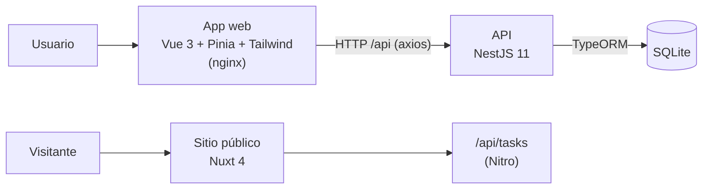
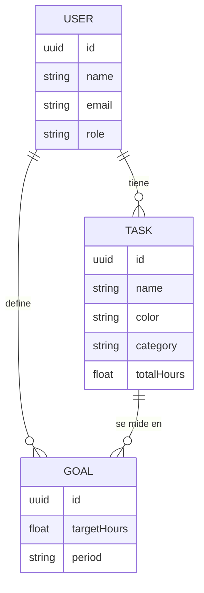

# ChronoView

Registro de tiempo por tareas: cada persona crea sus tareas por categoría, les suma horas, se pone metas y ve en gráficos en qué se le va el tiempo.


El proyecto tiene tres partes:

- **App web (`frontend/`)**: SPA en Vue 3 donde el usuario registra tareas, horas y metas, y ve sus estadísticas.
- **API (`backend/`)**: REST en NestJS con TypeORM y SQLite.
- **Sitio público (`nuxt/`)**: inicio, blog, consejos de productividad y FAQ, con un modo de renderizado distinto por ruta.

## Funcionalidades

| Sección | Qué hace |
|---|---|
| **Tareas** | Crear tareas con nombre, color y categoría (Work, Study, Fitness, Health…), sumarles horas y eliminarlas |
| **Metas** | Fijar una meta de horas por tarea y ver el progreso en porcentaje |
| **Estadísticas** | Total de horas, promedio diario, tarea más productiva, distribución por tarea (dona) y vista semanal (barras) |
| **Ajustes** | Idioma (inglés / español) y formato de hora (12 h / 24 h), guardados en el navegador |
| **Admin** | Horas totales de todos los usuarios, categorías activas, categoría con más tiempo y lista de usuarios |
| **Cuentas** | Registro e inicio de sesión, con roles `user` y `admin` |

## Arquitectura



### Modelo de datos



Borrar un usuario o una tarea borra en cascada sus metas.

### API

Todas las rutas van bajo el prefijo `/api`.

| Método | Ruta | Descripción |
|---|---|---|
| `POST` | `/auth/register` | Crear cuenta |
| `POST` | `/auth/login` | Iniciar sesión |
| `GET` | `/users`, `/users/:id` | Listar usuarios / ver uno |
| `GET` | `/tasks`, `/tasks/:id`, `/tasks/user/:userId` | Listar tareas, una o las de un usuario |
| `POST` | `/tasks` | Crear tarea |
| `PATCH` | `/tasks/:id/hours` | Sumar horas a una tarea |
| `DELETE` | `/tasks/:id` | Eliminar tarea |
| `GET` | `/goals`, `/goals/:id`, `/goals/user/:userId` | Listar metas, una o las de un usuario |
| `POST` | `/goals` | Crear meta |
| `DELETE` | `/goals/:id` | Eliminar meta |

### Sitio público con Nuxt

Cada ruta usa el modo de renderizado que mejor le encaja:

| Ruta | Modo | Por qué |
|---|---|---|
| `/` | SSR | Inicio, se genera en cada petición |
| `/blog/**` | Prerender | Los artículos no cambian: se generan como HTML estático al compilar |
| `/tasks/**` | SSR | Lee el catálogo de tareas de una ruta de servidor (`server/api/tasks`) |
| `/tips/**` | CSR | Consejos y FAQ, renderizados en el navegador |

## Stack

| Capa | Tecnologías |
|---|---|
| App web | Vue 3, Vue Router, Pinia, Tailwind CSS 4, Chart.js, axios, Vite |
| API | NestJS 11, TypeORM, SQLite |
| Sitio público | Nuxt 4, Nitro, Bootstrap 5 |
| Despliegue | Docker Compose, nginx |
| Calidad | TypeScript, ESLint, oxlint, Prettier |

## Estructura

```
.
├── backend/              API en NestJS
│   └── src/
│       ├── auth/         Registro e inicio de sesión
│       ├── users/        Usuarios y roles
│       ├── tasks/        Tareas y suma de horas
│       ├── goals/        Metas por tarea
│       └── home/         Estado de la API
├── frontend/             App web en Vue 3
│   └── src/
│       ├── views/        Tareas, metas, estadísticas, ajustes, admin, login
│       ├── components/   Gráficos (dona, barras), tarjetas de tarea y de estadística
│       ├── services/     Llamadas a la API
│       └── stores/       Estado con Pinia
├── nuxt/                 Sitio público: inicio, blog, tips, FAQ
└── docker-compose.yml
```

## Cómo correrlo

**Requisitos:** Node.js 20 o superior.

**1. API**

```bash
cd backend
npm install
npm run start:dev          # http://localhost:3000/api
```

La base de datos SQLite se crea sola al arrancar.

**2. App web**

```bash
cd frontend
npm install
echo "VITE_API_URL=http://localhost:3000/api" > .env
npm run dev                # http://localhost:5173
```

**3. Sitio público**

```bash
cd nuxt
npm install
npm run dev                # http://localhost:3000 (o el siguiente puerto libre)
```

## Estado y limitaciones

Es un proyecto de aprendizaje y le faltan piezas para producción:

- Las contraseñas se guardan sin hash y no hay tokens de sesión: el usuario queda guardado en el navegador después del login.
- Las rutas de administración se protegen solo en la interfaz; la API no comprueba el rol.
- La vista semanal de estadísticas reparte el total de horas entre los días, porque todavía no se guarda la fecha de cada registro.
- SQLite con `synchronize: true` es cómodo para desarrollo, pero en producción haría falta usar migraciones.

## Autores

- **Diego Chourio Garcia**: app web en Vue y sitio público en Nuxt · [LinkedIn](https://www.linkedin.com/in/diego-eduardo-chourio-garcia-472291385/)
- **Leidy Obando**: API en NestJS y sitio público en Nuxt
